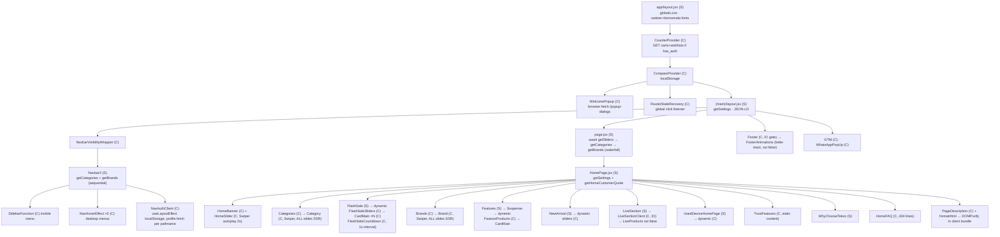

# Performance Audit: tekzo.com.bd homepage (mobile)

- **Mode:** read-only forensic audit. No fixes applied; no build, no installs.
- **Inputs:**
  - PSI mobile, Lighthouse 13.6, 23 Nov 2026
  - local source on branch `alamin`
  - the live production HTML and JS/CSS chunks, downloaded 23 Nov 2026 to the session scratchpad (outside the repo)
- **Labels:**
  - **VERIFIED**: confirmed in local source and/or the live response
  - **INFERRED-FROM-PROD-CHUNK**: identified by grepping minified production chunks (no source maps)
  - **UNVERIFIED**: plausible but not proven; needs the check listed

> **Deployed commit (Phase 2, VERIFIED).** Production was built from **`169994f`** ("add responsive image sizes…"). It has `sizes:"80px"` from that commit and the two-column FAQ grid from `5228d82`.
> - The only later commit, `e86c110` (current `main`/`alamin` HEAD), changes `public/icons/ShoppingBagIcon.jsx` and an SVG that nothing in `src/` imports.
> - `git diff --stat 169994f HEAD -- src next.config.mjs package.json` is **empty**, so every `file:line` below is valid for **both** deployed and HEAD.
> - **No finding is DIFFERS-IN-PROD.** The Phase 1 note that production differed was against the older local `alamin` at that time.

---

## 1. Executive summary

> **Phase 3 verdicts (measured, §9):**
> - **INP/TBT: third parties.** Blocking `gtm.js` cuts TBT 1,634 → 396 ms (−76 %) and the worst tap 432–640 → 240 ms. TikTok's and Facebook's per-tap handlers and the GTM container execution right after the first scroll are the drivers.
> - **LCP: CSS-gated first paint** (CSS slowed by Bornomala/JS bandwidth contention) plus first layout of the large DOM. Blocking Bornomala gives −0.45 s real / ≈ −1 s simulated; GTM has no LCP effect.
> - The "UNVERIFIED" labels in points 1 and 3 below are resolved by §9.

1. **INP 460 ms (field)**
   - **Most likely cause: third-party work landing right after the first interaction.** GTM, gtag, FB, TikTok and Clarity add ~1.7 s of CPU (PSI #8), and they load on the user's first `scroll`/`touchstart`/`click` (`GTM.jsx:31-58`). Taps in the next 1–2 s queue behind it. **UNVERIFIED**: needs field INP attribution.
   - **Contributing:**
     - hydration of a 2,700-element DOM with 373 client `<Link>` wrappers and 9 Swiper instances (6 autoplaying, one continuous marquee)
     - un-memoized root context values
2. **TBT 1,160 ms (lab)**
   - React DOM hydration is the largest single cost: `3lbm` ≈ 1.9 s CPU.
   - Swiper initialisation: `1-do` + `2xb` ≈ 1.3 s, including forced reflows.
   - Parsing 700 KB of HTML (507 KB markup + 175 KB RSC payload) ≈ 1.9 s.
   - GTM tags, which load inside the Lighthouse window after `load`.
3. **Lab LCP 7.3 s vs field 2.4 s**
   - The LCP candidate (the hero ``) is server-rendered, eager, `fetchPriority="high"` and preloaded, so **discovery is not the problem**.
   - Its 12 KB download competes with **~506 KB of high-priority font preloads**: 429 KB of Bornomala TTF that the homepage needs **only for the "৳" glyph**, plus 77 KB of Switzer. It also competes with ~900 KB of JS.
   - Render then waits behind a congested main thread.
   - The 7.3 s is mostly Lantern-modelled load/render delay. **UNVERIFIED**: the PSI "LCP breakdown" sub-parts are needed to split load delay from render delay.
4. **Biggest low-risk wins**
   - Subset Bornomala to WOFF2 and stop preloading it.
   - Give badge/logo/category images real sizes or `sizes`.
   - Let Cloudflare cache `/_next/image` and SVGs.
   - Fix the `RouterStaleRecovery` 2 s hard-reload.
   - Stop server-rendering every off-screen category/brand slide.
   - Ship DOMPurify server-side only.

---

## 2. Architecture & data-flow map

| Item | Finding | Status |
|---|---|---|
| Next / React | `next@16.4.6`, `react@19.2.3`, App Router, Turbopack chunks (`turbopack-*.js`) | VERIFIED (`package.json`, live chunk names) |
| Browserslist | none, so Next's default targets apply: Chrome/Edge/Firefox 111, Safari 16.4 (`node_modules/next/dist/docs/03-architecture/supported-browsers.md`) | VERIFIED |
| TS / JS config | `jsconfig.json` (paths only); no `tsconfig` | VERIFIED |
| `next.config.mjs` | `output: "standalone"`; security headers plus report-only CSP (`:42-55`); `images.formats: ["image/webp"]`, `minimumCacheTTL: 2678400`, 4 `remotePatterns` (`:76-114`); `experimental.serverActions.allowedOrigins`; `logging.fetches.fullUrl`. No `inlineCss`, `optimizePackageImports`, redirects or compiler options. | VERIFIED |
| Tailwind | v4 via `@tailwindcss/postcss` (`postcss.config.mjs`). `globals.css:1-6` = `@import "tailwindcss"` + 4 Swiper CSS imports + `theme.css`. No `@source` restriction, so the whole repo is scanned and one global stylesheet is produced. `tailwind.config.js` is not loaded by v4. | VERIFIED |
| Proxy (middleware) | `src/proxy.js`, matcher = all pages except static/`_next`. On `/`: legacy-redirect regexes plus a `has_auth` cookie sync. **No fetch on public pages** (the profile fetch only runs on `/dashboard`). Cheap. | VERIFIED |
| HTML caching | `Cache-Control: s-maxage=31536000` (ISR). The homepage response carries **no `cf-cache-status`**, so Cloudflare does not cache HTML; it hits Node every time. | VERIFIED (live headers) |

### 2.1 Homepage render tree

S = Server Component, C = `"use client"`.

Why each client component is client, and what it imports (local source):

| Component | Why client | Heavy imports | Live chunk (INFERRED-FROM-PROD-CHUNK) |
|---|---|---|---|
| `HomeBanner`, `HomeSlider` | Swiper | `swiper/react`, `swiper/modules` | `2xb_p56fzlqxh.js` (47 KB raw) + Swiper core `1-donaxa7i2fw.js` (82 KB) |
| `CardMain` (18 importers) | image-loaded state, CartModal, compare | `react-icons/md`, `lucide-react`, `next/dynamic` | in `2xb` **and duplicated** in `2n89dh8odx6i_.js` (38 KB) |
| `Categories`, `Category`, `Brands`, `Brand`, `HomeFAQ`, `TrustFeatures`, `FlashSaleCountdown` | Swiper / accordion / interval; `TrustFeatures` has no reason | swiper, lucide | `2-xfmnhh8lzib.js` (34 KB) |
| `PageDescription` | accordion toggle | `@/lib/formatHtml` → `isomorphic-dompurify` | DOMPurify in `28slmjp3zeals.js` (31 KB) |
| Root providers + `WelcomePopup` + `RouterStaleRecovery` | context, effects | — | `3pxvh49i4lpd-.js` (22 KB) |
| `GTM`, `WhatsAppPopUp` | effects | — | `0d_7c79kc42n3.js` (23 KB) |
| `SidebarFunction` | open state | `react-icons/rx` | `1bg3_o0gtgyb3.js` (12 KB) |
| `NavAuthClient` | auth UI | react-icons | `00_13g0fwrqxc.js` (9 KB) |
| `PreFetchLink` (41 importers) | wraps `next/link` | — | `0vw-hnf3z_toe.js` (24 KB, with lucide icons) |
| Framework | — | React DOM + scheduler + Next `polyfill-module` | `3lbm-r_1xmrrq.js` (228 KB) |
| Framework | — | Next app router + `next/link` | `1r4tpu9kyu516.js` (160 KB) |
| Legacy-only | — | core-js 3.38.1 | `0cz1d0mv5g_q7.js` (113 KB), **`noModule`**, so modern browsers never fetch it |

- **Source maps:** `*.js.map` requests return **404**, so maps are not publicly served (good).
- **Initial JS:** 23 chunks referenced by the homepage HTML, ~887 KB raw in total (including the 113 KB `noModule` chunk).

### 2.2 Data flow (homepage)

| Fetch | Where | Caching | Notes |
|---|---|---|---|
| `getSliders`, `getCategories`, `getBrands` | server, `app/(main)/page.jsx:6-8` | `lib/api` tags, `revalidate:false` | **Sequential awaits**: a waterfall on a cold cache. Each is also deduped by React `cache()`. |
| `getSettings` | server, `(main)/layout.jsx` and again in `HomePage.jsx:17` | same | deduped |
| `getCategories` + `getBrands` | server, `Navbar2.jsx:12-13` | same | sequential again (cached) |
| Section fetchers (flash sale, features, new arrival, live, used) | server, in each section's server component | tagged | `Features` streams behind `<Suspense>` (`<template id="B:0">` in the live HTML) |
| `/popup-dialogs` | **browser**, `WelcomePopup.jsx:45` | none | every hard load, cross-origin |
| `/customer/carts`, `/customer/wishlists` | browser via BFF, `CounterContext` mount | none | logged-in only (`has_auth`) |
| `/customer/profile` | browser via BFF, `NavAuthClient.jsx:43-53` | none | on every pathname change |

No React Query, SWR, Redux or Zustand.

- **Serialized to the client:** the live HTML is **699,655 bytes raw** (62 KB zstd, 73 KB gzip).
  - **507 KB** is markup: 233 KB of `class` attributes, 84 KB of `srcSet`, 50 KB of inline SVG.
  - **175 KB** is the RSC flight payload, in 46 `self.__next_f` scripts.
  - This is the "HTML document 1,925 ms CPU" item.
- **Per section:** Popular Categories 115 KB (87 ``), Popular Brands 112 KB (92 ``), Flash Sale 81 KB, Best Tech Deals 62 KB, FAQ 40 KB.

### 2.3 Fonts (`src/lib/fonts.js`)

- **`next/font/local`, `display: "swap"`, preloaded by default.** Live HTML preloads 4 fonts:
  - `Bornomala_Bold` TTF: **225,072 B**
  - `Bornomala_Regular` TTF: **204,276 B**
  - Switzer Variable woff2: 43,220 B
  - Switzer VariableItalic woff2: 33,408 B
- **Bornomala** declares 7 weights (300–900) mapped onto 2 TTF files (`fonts.js:19-56`).
  - It is a **fallback** in every stack (`globals.css:28-38`, `theme.css:9-12`).
  - The only non-Latin glyph on the homepage is **"৳" (U+09F3), 40 occurrences**, so the browser needs Bornomala for that single character. VERIFIED.

### 2.4 Global CSS (PSI #1)

- **`2t_3g0b4az1nl.css`: 302,788 B raw / 42,648 B gzip.**
  - ~1,720 distinct classes: Tailwind utilities for the whole app, including dashboard `dark:` variants (15 KB raw / 1.9 KB gzip).
  - Swiper CSS (core + pagination + navigation + free-mode) 16 KB raw / 2.7 KB gzip.
  - 78 `@property` and 28 `@media` blocks.
- **`3x48slb3p_q8d.css` (1.9 KB):** the `@font-face` rules.
- No third-party CSS framework. The size comes from a single global Tailwind stylesheet for every route. VERIFIED.

### 2.5 Third parties (re-check of 2e)

- **In the repo:** only `Components/GTM/GTM.jsx`.
  - A `beforeInteractive` inline `form.submit` patch (`:78-95`).
  - A GTM loader with `strategy="afterInteractive"`, mounted only after `window.load` → `requestIdleCallback` (2 s timeout), **or** on the first `scroll`/`mousemove`/`touchstart`/`keydown`/`click`, **or** after 15 s (`:31-58`). It is mounted in `(main)/layout.jsx:130`. VERIFIED.
- **Not in the repo:** gtag `AW-…`, Facebook Pixel, TikTok Pixel, Clarity, the jsdelivr `clientParamBuilder.bundle.js` (Meta CAPI parameter builder), and server-side GTM at `server.tekzo.com.bd`. grep finds 0 references, so these come from the **GTM container**. VERIFIED (absence).
- **Cloudflare `beacon.min.js` / `/cdn-cgi/rum`:** not present in the HTML fetched by curl, so it is **injected by Cloudflare** (Web Analytics / RUM). UNVERIFIED for which product injects it.

---

## 3. Issues (sorted by impact)

Est. gain values are rough lab-metric estimates, not measurements.

| ID | Title | Metric(s) | Evidence | Root cause | Proposed fix (not applied) | Est. gain | Business risk | Owner | Verify |
|---|---|---|---|---|---|---|---|---|---|
| P1 | Third-party tags execute right after the first interaction | **INP**, TBT | PSI #8 (GTM 880 ms, FB 384, TikTok 280, Clarity 144), PSI #9 (274 KB unused 3P JS); `GTM.jsx:31-58` | The first touch/scroll loads GTM, which then loads every tag. Their 1.7 s of CPU overlaps the user's next taps. | Load GTM on `load` + idle only, dropping the scroll/touch triggers, or yield inside GTM (tag sequencing, "Initialization"/"Window Loaded" triggers). Move FB/TikTok to server-side GTM (already present: `server.tekzo.com.bd`) and remove the browser pixels where CAPI covers them. Audit duplicate gtag/AW tags. | INP −100–250 ms (UNVERIFIED) | **Med-High**: attribution and conversion tracking; must be validated in GTM Preview and ad platforms | Marketing-GTM + Dev | Field INP attribution (web-vitals `attribution` build or CrUX/RUM), and the Performance panel: tap within 2 s of the first scroll |
| P2 | 429 KB Bornomala TTF preloaded for one glyph | **LCP**, FCP, payload | PSI #10; live preload tags; `fonts.js:19-56`; "৳" is the only Bengali glyph | TTF, unsubset, `preload` defaults to true, fallback font needed only for U+09F3 | Subset Bornomala to the Bengali block (or just ৳ + digits) as **woff2**. Set `preload: false` and add `declarations: [{ prop: "unicode-range", value: "U+0980-09FF" }]` (supported by `next/font/local`, see `next/dist/docs/01-app/03-api-reference/02-components/font.md`). Alternative: render "৳" from Switzer-compatible text ("Tk") or an SVG. Collapse 7 declared weights to 2. | −400 KB high-priority bytes; lab LCP −1–2 s (UNVERIFIED) | Low: verify Bengali pages (if any) still render correctly | Dev | PSI network tree: no TTF; check ৳ renders on mobile Safari and Chrome |
| P3 | Hydration cost of the whole homepage | **TBT, INP** | PSI #8 (`3lbm` 1,900 ms, HTML doc 1,925 ms); 2,732 elements, 289 ``, 373 `data-nav-recovery` links | Most sections are client components (§2.1); every card, tile and link hydrates; all off-screen slides are SSR'd | (a) Render only the first slide's items on the server and lazy-mount the rest (Swiper `virtual`, or slice on the server and fetch more on interaction). (b) Convert static client components to server: `TrustFeatures`, `HomeFAQ` (`
`), the slide markup of `Brands`/`Categories`. (c) Wrap below-the-fold sections in one reusable `IntersectionObserver` lazy-mount. | TBT −300–600 ms (UNVERIFIED) | Med: carousel behaviour, SEO internal links (keep links crawlable via a server-rendered "view all" or sitemap) | Dev | Lighthouse TBT, DOM size audit, React Profiler hydration time |
| P4 | Every category and brand is SSR'd into hidden slides (PSI #12) | TBT, INP, payload | `Category.jsx:29-70`, `Brand.jsx:30-65` (chunks of 8, all slides rendered); sections 115 KB + 112 KB of markup | The "repeated category entries" in the PSI a11y list come from **these sliders, not the menus**: the nav is only 14 KB with 14 anchors | As P3(a): first slide SSR plus lazy remainder, or a non-carousel grid of the top 8 with a "View all" link. **SEO check (Phase 2, VERIFIED on live):** all 84 carousel category links are on `/categories` and all 92 brand links are on `/brands`. 82/84 and 92/92 are in the sitemap; **missing from the sitemap: `/categories/hair-dryer` and `/categories/mobile-mount`**. Both index pages are linked from the homepage outside the carousels (`/categories` ×5, `/brands` ×2). **No link is discoverable only through the carousels.** | ~200 KB raw HTML, ~180 images and links fewer to hydrate | Low (after the sitemap gap is fixed) | Dev | HTML size; DOM size audit |
| P5 | Oversized intrinsic image sizes / missing `sizes` (PSI #6) | payload, LCP (bandwidth), server CPU | `CardMain.jsx:140,151,158,164,208,221` (`width={4000}`, no `sizes`, so `w=3840` is requested for 98×32 badges); `Category.jsx:13-19` and `Brand.jsx:13-16` (`width={140}`, no `sizes`, 384 served for 78 px); `Navbar2.jsx:93-101` (logo 300×250 shown at 40 px, preloaded high); `FooterPage.jsx:85`, `FooterBottom.jsx:65` | Intrinsic width drives the srcset when `sizes` is absent | Set real `width`/`height` (badges ~100×32, logo ~40×40) or `sizes="80px"`; use `unoptimized` for local SVG/WebP badges. 79 `width="4000"` imgs and 127 `w=3840` srcset entries are in the live HTML. | −199 KB (PSI estimate); fewer sharp encodes | Low | Dev | PSI "Improve image delivery" cleared |
| P6 | Cloudflare does not cache `/_next/image` or HTML; SVGs get 4 h TTL (PSI #5) | TTFB, LCP (repeat), origin CPU | Live headers: `/_next/image` → `cf-cache-status: DYNAMIC`; `/Offer.svg` → `max-age=14400`; HTML has no `cf-cache-status` | No Cloudflare cache rule for `/_next/image*`; Browser Cache TTL 4 h applied to `public/` assets | Cache rule: cache `/_next/image*` (respect origin 31 d, include `Accept` in the cache key or keep WebP-only), long TTL for `/*.svg` / `public` assets; optionally cache HTML with a short edge TTL and purge on revalidate | Faster image TTFB; big origin CPU relief | Med: wrong cache keys could serve the wrong format/size; HTML caching needs purge on price changes | Infra-Cloudflare | `curl -I` shows `cf-cache-status: HIT` |
| P7 | `RouterStaleRecovery` 2 s hard reload | INP-adjacent UX, wasted bandwidth | `RouterStaleRecovery.jsx:27-53`; wired via `PreFetchLink.jsx` `data-nav-recovery` (373 links on the home page) | Any internal click whose `pathname` has not changed after 2 s forces `window.location.href`: every slow mobile navigation (TTFB 0.8 s + RSC payload on 4G) and **every query-only link** (`?page=2`, filters), which always keeps the same pathname | Listener cost per click is negligible (`closest()` + `setTimeout`), so it is not an INP driver itself. Fix: compare `pathname + search`, raise the timeout (≥8 s), or reload only on an actual router error. Long term remove it once the stale-router cause is understood. | Removes double loads on slow networks | Low | Dev | Throttled (Slow 4G) click test: no full reload while the soft nav is in progress |
| P8 | Swiper: forced reflow and continuous autoplay (PSI #2) | TBT, INP | `1-donaxa7i2fw.js` = Swiper core (INFERRED-FROM-PROD-CHUNK: 45 "swiper" hits, `offsetWidth`/`clientWidth` reads); 9 instances on home: `HomeSlider.jsx:28-35` (2 s), `Category.jsx:51`, `Brand.jsx` (4 s), `SwiperSlider4/44/22/3` (2 s), `SwiperSliderAll.jsx:12-21` (`delay:0`, `speed:6000`, `loop`, `freeMode`: a never-ending marquee) | Each instance measures layout on init (after hydration DOM writes, so forced reflow), and autoplay transitions keep the main thread and compositor busy during taps | Init carousels lazily when they enter the viewport; pause autoplay when off-screen (IO) and on `prefers-reduced-motion`; replace the marquee with a CSS animation; drop unused `onAutoplayTimeLeft` callbacks (refs are never attached, e.g. `SwiperSlider4.jsx:10-17`) | TBT −100–300 ms (UNVERIFIED) | Low-Med (visual behaviour) | Dev | Performance panel: no "Forced reflow" from Swiper during load |
| P9 | DOMPurify shipped and run on the client | TBT, payload | `PageDescription.jsx:1-5` (`"use client"` + `formatHtml`) → `isomorphic-dompurify`; live chunk `28slmjp3zeals.js` (31 KB, DOMPurify signatures, INFERRED-FROM-PROD-CHUNK) | Sanitization happens in a client component | Sanitize on the server (in the server parent) and pass the HTML string to a small client accordion | −31 KB JS, less hydration CPU | Low (keep sanitization server-side: XSS defence unchanged) | Dev | Chunk no longer present on `/` |
| P10 | Render-blocking 42.7 KB CSS (PSI #1) | FCP, LCP | §2.4; single global Tailwind stylesheet + Swiper CSS (`globals.css:1-6`) | One stylesheet for all routes, render-blocking `<link>` | Evaluate `experimental.inlineCss: true` (documented in `next/dist/docs/.../inlineCss.md`; recommended for Tailwind; trade-off: no separate CSS caching, duplicated in RSC payload). Import Swiper CSS only where used. | FCP/LCP −200–470 ms on first visit (UNVERIFIED) | Med: experimental flag; HTML grows ~43 KB gzip | Dev | PSI render-blocking audit; compare FCP |
| P11 | Un-memoized context values and layout effects at root | INP | `CounterContext.jsx:110` (`value={{…}}` new object each render); `CompareContext.jsx` value; `NavAuthClient.jsx:35` `useLayoutEffect` reading `localStorage` (synchronous re-render before paint); `CardMain` now calls `useCompare()` (`CardMain.jsx:63`), so every card re-renders on any compare change | Context churn re-renders all consumers | `useMemo` the provider values; split state/actions contexts; move the cached-user seed out of the layout-effect path | Small–Med INP | Low | Dev | React Profiler: no card re-renders on badge or compare updates |
| P12 | Homepage fetch waterfall | TTFB (cold cache), LCP | `page.jsx:6-8` sequential awaits; `Navbar2.jsx:12-13` sequential | Cold ISR regeneration waits for each fetch in turn | `Promise.all`; let sections fetch inside `<Suspense>` | Cold TTFB −(2 × API latency) | Low | Dev | Server timing on a cold render |
| P13 | Duplicate `CardMain` + `swiper/react` + `SearchBar`: the `(main)` 404 boundary ships on every page | payload, parse, TBT | **VERIFIED by `next analyze` at `169994f`** (see §8). `0w67jqb9d6vic.js` (= prod `2xb`, 46.6 KB / 19.2 KB gz) = homepage sections. `0lzgni6aoo4--.js` (= prod `2n89`, 38.1 KB / 14.6 KB gz) = `app/(main)/not-found.jsx:1-13` → `ClientNotFoundContent.jsx` + `FeatureProductFor404Page.jsx` + **its own copies** of `CardMain.jsx` (10 KB), `swiper/react` (16 KB) and `SearchBar.jsx`. | The `(main)` segment's `not-found.jsx` is a render-dependent group of the layout, so its client modules load on **every** `(main)` page. Turbopack emits them as a separate joined chunk rather than sharing them with the page's chunk. | Keep the 404 boundary light: render its product section via `next/dynamic` inside `ClientNotFoundContent`, or make the 404 content server-rendered with no `CardMain`/`SearchBar` import at the boundary level | −38 KB raw / −14.6 KB gz on every `(main)` page | Low (404 page visuals only) | Dev | Re-run `next analyze`: `0lzg…` absent from route `/` |
| P14 | "Legacy JS" polyfills (PSI #7) | payload | `3lbm` contains Next's built-in `polyfill-module` (`trimStart`, `flat`/`flatMap`, `fromEntries`, `at`, `hasOwn`, `URL.canParse`), INFERRED-FROM-PROD-CHUNK; core-js chunk `0cz1` is `noModule` (never loaded by modern browsers) | Shipped by Next itself; not from app browserslist (none set; Next defaults are already modern) | No app-level fix; do not add a browserslist expecting gains. Re-check after Next upgrades. | ~few KB | — | — | — |
| P15 | Hero carousel risks | LCP (when a video is first) | `HomeBanner.jsx:30-39`: video slide 0 gets `preload="auto"` with no `poster`; currently **no `<video>` in the live HTML** (slide 0 is the 11.11 image, preloaded) | CMS-dependent | Require a `poster` (and preload it) for video slides; on mobile use `preload="metadata"` or an image | Prevents a future LCP regression | Low | Dev + Content | Check the PSI LCP element when the CMS puts a video first |
| P16 | Lottie footer | INP (scroll), CPU | `Footer.jsx:11-34` IO gate (corrected in Phase 2; Phase 1 cited concatenated `cat -n` numbering) (`rootMargin: 300px`); `FooterAnimations.jsx` uses **`lottie-react` (full lottie-web player)**; JSON: `water-wave.json` 3.8 KB, `robot-assistant.json` 19.5 KB; the wave renders inside `hidden md:block` but is still mounted on mobile | Not eager (good); no lottie code in the initial chunks (VERIFIED by grep of the live chunks). Animations loop forever once mounted. | Use the light player (`lottie-web/build/player/lottie_light`) or CSS/WebM; don't mount the wave on mobile; pause when off-screen | Minor | Low | Dev | No lottie chunk until scroll; no rAF loop when the footer is off-screen |
| P17 | Image-gated cards | LCP (lab), CLS | `CardMain.jsx:188` skeleton overlay until JS `onLoad`; images `opacity-0` until `imageLoaded` (`:199`) | A card image is invisible until hydration + `onLoad`. This is the "skeleton first frame" for product cards (23 skeletons in the live HTML). | Show the image without JS (CSS-only placeholder, or `placeholder="blur"`) | Visual completeness earlier | Low | Dev | Filmstrip |
| P18 | `WelcomePopup` browser fetch on every load | INP, network | `WelcomePopup.jsx:45` | Cross-origin client fetch at root | Fetch on the server (tagged cache) and pass as props | One fewer request | Low | Dev | Network panel |
| P19 | Root redirect `tekzo.com.bd` → `www` (PSI #4) | TTFB for apex visitors | `curl`: apex returns 301 in ~57 ms, issued by Cloudflare | Expected canonical redirect | Make sure ads, links and GBP use `https://www.`; add HSTS preload (header already set) | One round trip for apex entries | Low | Marketing + Infra | Link audit |
| P20 | No preconnects; critical chain via the Cloudflare beacon (PSI #3) | FCP | Live HTML: 0 `preconnect`; images are served same-origin via `/_next/image`, so CloudFront needs no preconnect | The beacon is injected by Cloudflare | Disable Cloudflare RUM/Web Analytics injection if GTM/Clarity already cover it, or accept it (async) | Small | Low | Infra-Cloudflare | Critical-chain audit |

---

## 4. Outside the codebase

- **GTM container (`GTM-P2B3DNBX`)**
  - Tag inventory and firing triggers.
  - gtag `AW-…` (563 ms CPU) plus Meta, TikTok and Clarity.
  - Duplicate pageview tags.
  - Server-side container `server.tekzo.com.bd`: the report-only CSP `frame-src` violation (PSI #11). The CSP lacks it in `frame-src`; add it when the CSP is enforced.
  - jsdelivr `clientParamBuilder` (18 KB, short cache).
- **Cloudflare**
  - Cache rules for `/_next/image*`, `public/*.svg` and optionally HTML.
  - Browser Cache TTL (currently 4 h).
  - RUM / Web Analytics beacon injection.
  - Bot Fight Mode / AI-crawler settings (already noted in `docs/diagnosis/10-geo-fixes.md`).
- **CSP (PSI #11):** report-only, with no `report-uri`/`report-to`. Violations for cloudflareinsights, doubleclick, clarity, jsdelivr and `server.tekzo.com.bd` need allow-list updates before any enforcement. That is a config change in `next.config.mjs:42-55`, owned jointly by Dev and Marketing.

---

## 5. Quick wins vs. structural changes

**Quick wins (low risk, high impact)**
- **P2:** Bornomala subset to woff2, `preload:false`, `unicode-range`.
- **P5:** real image sizes and `sizes`; `unoptimized` for local badges.
- **P6:** Cloudflare cache rules for `/_next/image` and SVGs (infra only).
- **P7:** `RouterStaleRecovery`: compare `pathname+search`, longer timeout.
- **P9:** server-side sanitization for `PageDescription`.
- **P11:** memoize the context values.
- **P12:** `Promise.all` in `page.jsx` and `Navbar2`.
- **P8 (partial):** remove the unused `onAutoplayTimeLeft` callbacks; pause autoplay off-screen.

**Structural (needs staging and QA)**
- **P1:** GTM trigger strategy and server-side tagging. Needs Marketing sign-off.
- **P3 / P4:** reduce what is SSR'd and hydrated: first-slide-only carousels, server components for static sections, lazy-mount below the fold.
- **P10:** `experimental.inlineCss` evaluation.
- **P13:** chunk dedupe (needs a bundle analyzer run; requires approval).
- **P17:** card image visibility without JS.

---

## 6. Docs reconciliation (`docs/diagnosis/*`)

| Claim (doc) | Status |
|---|---|
| Next 16.1.4 baseline (`00-architecture-map.md`) | **STALE**: now 16.4.6 |
| Root layout wraps every route in Counter/Compare providers + WelcomePopup + RouterStaleRecovery (`03`, `00`) | CONFIRMED |
| Home `page.jsx` sequential fetch waterfall (`05` §4) | CONFIRMED |
| HomeBanner `"use client"`, autoplay video, `preload="auto"` on slide 0 (`05`, `04`) | CONFIRMED in code. Currently **no video live**. |
| GTM `beforeInteractive` (`06`) | PARTLY STALE: only the form-submit patch is `beforeInteractive`; the GTM loader is `afterInteractive` and deferred to load, idle or interaction |
| Switzer ships 20 weights (`06`, `14`) | **STALE**: only the Variable + VariableItalic woff2 are referenced |
| Bornomala raw TTF (`14`) | CONFIRMED. New: it is needed only for "৳". |
| 4000×3000 badge images (`04`, `14`) | CONFIRMED (live HTML: 79 instances) |
| `RouterStaleRecovery` hard reload after 2 s, blind to query-only navigation (`04`) | CONFIRMED |
| Footer Lottie gated by IntersectionObserver (`06`) | CONFIRMED. Package is full `lottie-react`; JSON 3.8 + 19.5 KB. |
| No error boundaries (`06`) | **STALE**: `(main)/error.jsx` exists; `global-error.jsx` and the dashboard one are still missing |
| Tailwind v4 does not load `tailwind.config.js` (`00-cleanup-plan`) | CONFIRMED (no `@config`/`@plugin` in `globals.css`) |
| Context values not memoized (`03`) | CONFIRMED (`CounterContext.jsx:110`) |
| Duplicate mobile and desktop menus (PSI hypothesis) | **REFUTED**: nav markup 14 KB. The repeats come from the category/brand sliders (P4). |

---

## 7. Open questions

**Phase 2 status:**
- **Q1 ANSWERED** (`169994f`, identified from the live chunks).
- **Q6 ANSWERED** (analyzer run, §8).
- **Q2–Q4 STILL OPEN.** The Phase 2 brief contained template placeholders (`<x>ms`, `<paste…>`) instead of the PSI LCP breakdown, the GTM/Bornomala blocking-experiment numbers and the Clarity data. Without them, the INP verdict and the font-vs-render-delay split stay **UNVERIFIED**.

1. **Which commit is deployed?** The live CardMain differs from `alamin` and `feat/card-button-swap`. Tell me the deployed SHA so line references can be matched exactly.
2. **PSI collapsed sections:** please paste "LCP breakdown" (TTFB / load delay / load time / render delay), the LCP element selector, "Layout shift culprits" and "Avoid an excessive DOM size". They decide between the bandwidth explanation (P2) and the render-delay explanation (P3) for the 7.3 s.
3. **Field INP attribution:** is there any RUM (Clarity, Cloudflare Web Analytics or GA4 web-vitals) with interaction target and phase breakdown? It is needed to confirm P1 vs P3 as the main INP driver.
4. **GTM:** confirm whether FB and TikTok are browser pixels, server-side only, or both (P1), and whether the AW gtag is loaded twice (GTM tag plus Google tag).
5. **Bengali content:** does any route render Bengali beyond "৳"? This decides between a full-block subset and a ৳-only subset (P2).
6. **Bundle analyzer:** may I run one `next build` with analysis later? It is needed to confirm P13 and the exact chunk→module map.
7. **pm2:** cluster or single instance? This affects whether HTML edge-caching plus revalidate purge (P6) is safe.

---

## 8. Phase 2: bundle analysis (`next analyze`, VERIFIED)

**How it was run**
- Separate worktree `../tekzo-audit` at `169994f`, with `npm ci` (lockfile unchanged).
- Command: `next analyze --output --snapshot audit-1`, then `next analyze export --route /`.
- `next analyze` compiles with Turbopack but **does not prerender**, so the unreachable backend was not needed. No workaround was used.
- The worktree was **removed** afterwards (`git worktree remove --force` + `prune`). The user's working tree and `.next` were not touched.

**Client chunks for route `/`** (analyzer names, with the production name where sizes match):

| Analyzer chunk | Prod chunk | Raw | Gzip | Largest contents |
|---|---|---|---|---|
| `3ex2cq_u97-q8.css` | `2t_3g0b4az1nl.css` | 302.8 KB | 41.7 KB | `globals.css` (Tailwind + Swiper CSS) |
| `0ct6jkh9zhymq.js` | `1-donaxa7i2fw.js` | 81.6 KB | 26.0 KB | `swiper` core 79 KB |
| `0w67jqb9d6vic.js` | `2xb_p56fzlqxh.js` | 46.6 KB | 19.2 KB | `swiper/react` 16 KB, `CardMain` 10 KB, FeatureProducts, FlashSaleSliders, NewArrivalSliders, SwiperSlider4/44/22, PageDescription, SearchBar |
| `0lzgni6aoo4--.js` | `2n89dh8odx6i_.js` | 38.1 KB | 14.6 KB | **404 boundary**: `swiper/react` 16 KB (dup), `CardMain` 10 KB (dup), SearchBar (dup), FeatureProductFor404Page, ClientNotFoundContent |
| `415jg068of5jn.js` | `2-xfmnhh8lzib.js` | 34.5 KB | 13.8 KB | **`HomeFAQ` 19 KB** (Q&A text compiled into JS), Brand, Category, TrustFeatures |
| `34h6r3c3lmn9f.js` | `28slmjp3zeals.js` | 30.7 KB | 11.7 KB | `dompurify` 28 KB (via `PageDescription` → `formatHtml`) |
| `0i_vz7bhts6pt.js` | `0vw-hnf3z_toe.js` | 24.2 KB | 12.8 KB | Next `link`/shared, `PreFetchLink`, lucide |
| `1nwij-46w84rl.js` | — | 22.1 KB | 9.5 KB | Navbar `ModalBox`, `NavAuthClient`, `NavCountBadges`, `FooterBottom` |
| `2yo459td7otdl.js` | `3pxvh49i4lpd-.js` | 22.0 KB | 10.5 KB | root: `WelcomePopup`, `CounterContext`, `CompareContext`, `RouterStaleRecovery` |
| `446r0130k3l0a.js` | `1bg3_o0gtgyb3.js` | 12.2 KB | 5.5 KB | mobile `SidebarFunction` + both `SidebarItems` |

(React DOM, the Next router runtime and the polyfill chunks are framework chunks outside the route graph above.)

**Duplicate explained (P13):**
- `app/(main)/not-found.jsx` is a *render-dependent* group joined to every page of the `(main)` segment.
- Its imports (`ClientNotFoundContent` → `FeatureProductFor404Page` → `CardMain`, `SwiperSlider4`, `SearchBar`) are emitted as their own chunk instead of sharing the page chunk.
- Net duplicate cost on every `(main)` page: ~38 KB raw / 14.6 KB gzip.
- The 646 KB `not-found.json` Lottie is an **async** group: it is fetched only when the 404 actually renders. Good, no change needed.

---

## 9. Phase 3: lab experiments and verdicts (23 Nov 2026)

**Setup** (all read-only on the live site; no login, cart or form):
- Lighthouse **13.6.0** CLI (the same version as PSI), mobile preset, run with `npx` from a scratch folder outside the repo, headless Chrome 157.
- Interaction traces via `puppeteer-core`:
  - 412×823 @1.75 DPR, touch, **4× CPU**, Lighthouse mobile network (150 ms RTT, 1.6 Mbps down)
  - load, then scroll + tap carousel pagination bullets + tap 4 FAQ accordion buttons (no links)
  - Event Timing + Long Animation Frame (LoAF) script attribution
- No interactive browser tool was attached to this session, so "DevTools" here means Chrome driven over CDP. Traces were saved outside the repo.

### 9.1 Blocking experiment (Lighthouse mobile, average of 3)

| Config | Perf | FCP | LCP | TBT | SI | Runs (Perf / LCP / TBT) |
|---|---|---|---|---|---|---|
| Baseline | **46** | 1.54 s | **8.06 s** | **1,634 ms** | 4.69 s | 46/7.9/1705 · 45/8.1/1741 · 46/8.2/1458 |
| `gtm.js` blocked | **64** | 1.57 s | 8.04 s | **396 ms** | 3.75 s | 67/7.9/325 · 60/8.2/495 · 65/8.0/370 |
| Bornomala blocked | 48 | 1.53 s | 7.10 s (noisy) | 1,636 ms | 4.11 s | 45/9.2/1653 · 47/6.7/1648 · 52/5.4/1606 |

(This machine's baseline TBT is ~470 ms higher than PSI's 1,160 ms. The relative deltas are what matter.)

### 9.2 LCP verdict: **render-blocked by CSS arrival + first layout, made worse by font bandwidth contention**

- **LCP element:** the hero image `div.swiper-wrapper > div.swiper-slide > a.block > img.w-full` (`alt="banner image"`, 11.11 banner, `w=750`) in all 9 runs.
- **Lighthouse LCP breakdown** (observed, unthrottled trace; baseline): TTFB 103–266 ms · resource load delay 26–70 ms · resource load duration 80–120 ms · **element render delay 516–616 ms** (the largest part).
- **Throttled trace (4× CPU, 1.6 Mbps):**
  - **FCP = LCP = 3.2–3.4 s.** The hero image finishes at **1.73 s**, but nothing can paint until:
    - the render-blocking CSS (`2t_3g0b4az1nl.css`, 42 KB) arrives at **2.89 s**. It started at 0.27 s and is slowed by sharing 1.6 Mbps with the preloaded Bornomala TTFs (downloading until 6.8 s) and ~23 JS chunks.
    - the first style/layout pass on the 2,700-element DOM runs: two tasks of 164 ms + 272 ms (Layout 86 + 195 ms, UpdateLayoutTree 37 + 48 ms).
  - **With Bornomala blocked:** the CSS arrives at 2.48 s (−0.4 s) and **LCP = 2.85 s (−0.45 s, ≈ −14 %)**.
- **Theory status:**
  - "Font bandwidth contention" is **confirmed as a contributor** (≈ −0.45 s real, ≈ −1 s simulated, noisy).
  - "Main-thread render delay" is **confirmed** in the narrower sense of CSS-gated first paint plus first layout of a large DOM.
  - Hydration JS and GTM do **not** gate LCP: blocking GTM leaves LCP unchanged.
- **The lab LCP of 8 s is a Lantern extrapolation of this chain.** Real throttled LCP is ~3.3 s, and field LCP is 2.4 s.
- **New priority:** P10 (`experimental.inlineCss`) removes the CSS request from the critical path entirely. It is promoted to **PR 11, right after PR 1** in FIX_PLAN.

### 9.3 TBT / INP verdict: **third-party tags (GTM → TikTok, Facebook) are the primary cause**

- **TBT:** blocking `gtm.js` alone removes **1,238 ms (−76 %)** of TBT and raises Perf from 46 to 64. The remaining ~400 ms is first-party: React DOM `3lbm` hydration, Swiper and the Cloudflare challenge script.
- **Interactions** (worst entry per tap; delay / processing / presentation in ms):

| Tap | live run 1 | live run 2 | `gtm.js` blocked |
|---|---|---|---|
| 1st tap (carousel bullet, right after the first scroll) | **320** (260/2/58): GTM container 100 ms | **560** (508/3/48): GTM container 378 ms | 240 (177/2/61): no 3P |
| 2nd tap (bullet) | 152 | 208: GTM 852 ms in the window | 144 |
| FAQ tap 1 | **432** (60/1/372): **TikTok 184 ms**, FB 44, React 26 | **640** (88/1/551): **TikTok 308**, FB 53, React 47 | 176 |
| FAQ taps 2–4 | 288 / 320 / 352: TikTok 93–94 ms each | 304 / 280 / 336: TikTok 75–108 ms each | 184 / 176 / 208 |
| **Worst (≈ INP)** | **432 ms** | **640 ms** | **240 ms** |

- **Session LoAF script time:**
  - **Live:** React DOM 1.70 s · **GTM 1.22–1.44 s · TikTok 0.95–1.07 s · Facebook 0.74 s** · Cloudflare `/cdn-cgi/challenge-platform` 0.30–0.35 s · Clarity 0.11–0.30 s.
  - **GTM blocked:** React DOM 1.42 s, challenge script 0.38 s, and almost nothing else.
- **Mechanism:**
  1. The first scroll or touch triggers GTM (`GTM.jsx:34-57`). The container's execution then delays the next tap by 260–508 ms.
  2. After that, **every tap** runs TikTok's (and Facebook's) document-level click/pointer handlers, adding 75–308 ms of work before the next frame. That shows up as presentation delay.
- **Verdict:** INP ≈ 430–640 ms in the lab vs **460 ms field** (p75). This matches the field figure, and the excess is **third-party**. Without tags, the worst tap is ~240 ms: still "needs improvement", with a first-party floor of ~140–180 ms per tap.
- **First-party floor** (for PRs 5/8):
  - The FAQ tap costs ~130 ms of presentation even without tags: the grid-rows/opacity transition plus style recalc on a large DOM.
  - The first tap's 177 ms input delay with tags blocked comes from late hydration/Swiper work.
- **Also new: Cloudflare challenge-platform script** (0.3 s CPU). Bot Fight Mode / JS detections inject `/cdn-cgi/challenge-platform/…` into pages. **UNVERIFIED for real users:** headless Chrome may be challenged more often. Check Cloudflare Security → Bots settings (Infra).
- **Clarity / RUM data:** none provided. The verdict rests on the lab traces above.
